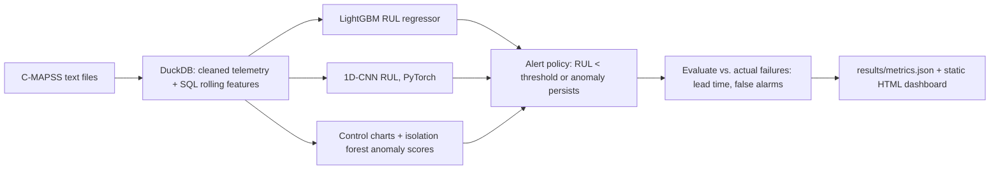

# Predictive Maintenance and Anomaly Alerting on Turbofan Engine Telemetry

`predictive-maintenance-ops` · new project · estimated build effort: 4 h

## Problem

Operations teams want warnings before equipment fails, without flooding technicians with false alarms. This project uses NASA's C-MAPSS run-to-failure sensor data. It builds a SQL feature layer, predicts remaining useful life (RUL) with LightGBM and a 1D-CNN, and adds an unsupervised anomaly detector (rolling z-score / control charts plus an isolation forest). It evaluates the alerts against actual failure times (lead time, false alarms per engine) and produces a static HTML operations dashboard.

## Target jobs and skills

- **Quarterhill — Operations Data Scientist** (`8890b6e5926e`): covers 71% of the JD's weighted top skills (Python, SQL, Statistics, Anomaly Detection, Machine Learning, Time Series, Data Visualization, Predictive Maintenance)

Skills/tools this project demonstrates: Python, SQL, Time Series, Anomaly Detection, Predictive Maintenance, Machine Learning, Gradient Boosting, LightGBM, Deep Learning, PyTorch, Statistics, SPC, Data Visualization, Feature Engineering

## Data

- **Dataset:** NASA C-MAPSS Turbofan Engine Degradation Simulation (FD001 and FD003) — https://www.nasa.gov/intelligent-systems-division/discovery-and-systems-health/pcoe/pcoe-data-set-repository/
- **License/terms:** NASA open data (public domain)
- **Size used:** ~200 engines per subset, 21 sensors, ~45 MB unzipped
- **Plan:** Split by engine unit; the official test sets with true RUL files are used once for final scoring.

## Architecture

## Tech stack

Python 3.11, DuckDB, LightGBM, PyTorch (CPU), scikit-learn, plotly, pytest

## Deliverables

- SQL feature layer (rolling means/slopes per sensor, operating-condition normalization for FD003)
- Two RUL models plus a piecewise-linear baseline
- Anomaly detector and alert policy tuned on validation engines
- Alert evaluation against actual failure cycles and a static HTML dashboard

## Success criteria (all must hold on a from-scratch `python run.py`)

| Metric | Threshold | How it is measured |
|---|---|---|
| FD001 test RUL RMSE | <= 18 cycles | official test set + RUL file |
| FD003 test RUL RMSE | <= 20 cycles | official test set + RUL file |
| Alert lead time | >= 15 cycles before failure for >= 80% of validation engines | run-to-failure validation engines |
| False alerts | <= 0.1 per engine before the final 50 cycles | same engines |
| Test coverage of src/ | >= 70% | pytest --cov |

## Baseline

Constant mean-RUL predictor and a simple threshold on the single most degraded sensor.

## Constraints

- Runs on Windows with `python run.py` from a fresh virtualenv; no make, shell scripts, paid APIs, or accounts.
- CPU-only by default (an optional `--device cuda` flag is fine); peak RAM <= 3 GB; total downloads <= 1.5 GB.
- PyTorch (if used) pinned to the CPU wheel via `--extra-index-url https://download.pytorch.org/whl/cpu`.
- Fixed random seeds; every reported number is written by code to results/metrics.json (never typed by hand).
- Test split is created once, saved, and never used for training, tuning, or threshold selection.
- Data download is scripted (Python requests), cached under data/, and verified by checksum or row count.
- Alert thresholds are tuned on validation engines only; the official test engines are scored once.

## Draft resume bullets (placeholders are filled only with reproduced metrics)

- Predicted remaining useful life on NASA C-MAPSS engine telemetry with LightGBM and a 1D-CNN, reaching [RMSE] RMSE (cycles) on the official FD001 test set
- Designed an alert policy combining RUL forecasts with control-chart and isolation-forest anomaly scores that warned [LEAD] cycles ahead for [PCT] of engines at [FA] false alerts per engine
- Built the SQL feature layer in DuckDB and a static operations dashboard for alert review
