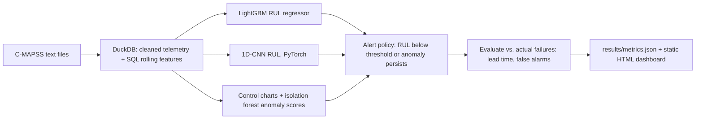
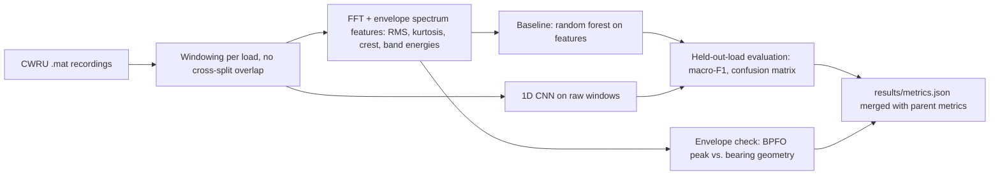

# Predictive Maintenance: Turbofan Alerts and Bearing Vibration Faults

This project extends a turbofan remaining-useful-life pipeline with the vibration checks a condition-monitoring team uses on a bearing test rig. NASA C-MAPSS subsets FD001 and FD003 train a LightGBM regressor and a one-dimensional CNN, with sensor features built in DuckDB SQL and alerts formed from the forecast, a control chart, and an isolation forest. Case Western Reserve University 12 kHz drive-end accelerometer recordings are windowed by motor load, transformed to FFT and Hilbert envelope spectra, and classified into 10 fault conditions with a random forest and a one-dimensional CNN. The classifiers are scored once on the 3 hp load, which is never used for training or early stopping.

## Setup

```
python -m venv .venv
.venv\Scripts\pip install -r requirements.txt
.venv\Scripts\activate
python run.py
```

`python run.py` downloads the NASA C-MAPSS zip and the CWRU `.mat` files into `data/` (cached and checksum-checked), trains the turbofan models and the bearing classifiers, writes `results/`, and runs the test suite to record coverage. The first run needs network access for the datasets and, if you have not installed the requirements yet, for PyTorch's CPU wheel.

## How to run

- `python run.py` reproduces the full FD001 and FD003 evaluation and the 10-class bearing evaluation.
- `python run.py --quick` runs the same steps on 12 development engines and 4 test engines per subset, and on three bearing classes with fewer windows and CNN epochs. It writes to `results/quick/` and is what the tests call. It is not the official score.
- `python run.py --device cpu` is the default. `--device cuda` is used only when a GPU is available.
- `python run.py --skip-coverage` skips the pytest coverage pass.
- `python run.py --output some\folder` changes the results directory.

## Architecture





## Design decisions

Training targets use the usual piecewise RUL: remaining cycles clipped at 125. That cap is fixed in `src/config.py` and was not chosen by looking at official test labels. Early in life the sensors barely move, so a linear target from cycle zero is a poor fit. The clip is applied only to the training target. Test RMSE uses the official RUL file, uncapped.

Development engines are split by unit id, 20 percent validation, seed 0. The assignment is saved under `data/splits/` and reused. Official test engines never enter training, early stopping, calibrator fitting, blend weights, or alert thresholds. After those choices are locked, the models are refit on the full development file and the test file is scored once.

FD001 and FD003 each get their own models. FD003 has two fault modes, so one shared model would mix different sensor directions. Operating settings are rounded into a regime key and sensors are z-scored inside each regime using training rows only. Both of these files are the single sea-level condition with a little setting noise, so the key collapses to one regime and the step is training-set standardization. The same function keeps regimes apart when settings differ by whole units, which the tests check with synthetic data.

The 3 hp recordings are the test load. Each fault class holds out either its 0 hp or its 1 hp recording for validation, alternating by class, and trains on the other development recordings. Every 2 hp recording stays in training, because 1750 rpm is the development speed closest to the 1730 rpm test load. A recording is listed in only one split, so no window shares samples with a window in another split. That is the usual leakage path on this dataset when people cut overlapping windows from one file and then shuffle them. The random forest sees RMS, excess kurtosis, crest factor, FFT band energies, envelope band energies, and envelope amplitude at the shaft, BPFO, BPFI, and ball-spin orders. The CNN sees the raw window after a per-window z-score. Neither model is fit on the test load, and the test load is not used to pick thresholds. The envelope check bandpasses 2 to 5 kHz, takes the Hilbert envelope, and finds the strongest peak between 2.5 and 5 times shaft speed. That band is wider than the theoretical outer-race frequency. The detected peak is then compared with BPFO from the SKF 6205-2RS geometry (9 balls, 0.3126 in ball diameter, 1.537 in pitch diameter).

The reported RUL is a validation-chosen blend of calibrated LightGBM and CNN forecasts. The calibrator is either a line or an isotonic map, and the blend weight is one of 0, 0.25, 0.5, 0.75, or 1. Both are fit only on validation cycles whose true remaining life is at most 25 cycles above the 125-cycle training clip. Isotonic regression is kept only when a split by validation engine beats the line. A health index uses the mean of train-signed sensor z-scores, and a second feature uses the worst sensor, so one fault mode does not cancel the other. A third feature is how close the current sensor deltas are to two end-of-life centroids fit on training engines only. Alert thresholds are a grid over validation engines only. A false alert is an episode that starts while true remaining life is still above 50 cycles. Lead time is the true remaining life at the first alert.

## Limitations

The bearing data come from one public test rig with seeded faults, not from a customer fleet or an IIoT deployment. Window-level scores on one held-out load are not a field false-alarm rate. Outer-race files are the load-zone-centered position only. The CNN is small and trained on CPU.

These are simulated engines, not a fleet maintenance program. Alert lead time and false alerts are measured on the same validation engines used to pick the thresholds, so those two figures are optimistic for a new set of engines. The official test RMSE is not used for any of those choices. FD003's two fault modes are handled by one tree model and one CNN, not by separate experts. The CNN is small and trained on CPU. RUL values above the 125-cycle training cap are harder because the sensors have little signal there. Do not use the alerts to schedule real maintenance.

## Dataset

NASA C-MAPSS Turbofan Engine Degradation Simulation, subsets FD001 and FD003, from the NASA Prognostics Center of Excellence: https://www.nasa.gov/intelligent-systems-division/discovery-and-systems-health/pcoe/pcoe-data-set-repository/

**License:** NASA open data, public domain (U.S. government work). There is no usage restriction on the files. The downloader caches them under `data/cmapss/` and checks row counts plus SHA-256.

Case Western Reserve University Bearing Data Center, 12 kHz drive-end accelerometer recordings (normal baseline plus inner-race, outer-race, and ball faults at 0.007, 0.014, and 0.021 inch): https://engineering.case.edu/bearingdatacenter/download-data-file

**License:** publicly provided by the CWRU Bearing Data Center for research use. Cite the Bearing Data Center. Files are cached under `data/cwru/` and checked with SHA-256.

## Evaluation artifacts

Metrics in `results/metrics.json` are computed from these tables after they are written:

| File | What it contains |
|---|---|
| `results/fd001_test_predictions.csv` | One row per official FD001 test engine. `row_id` includes the source line number. |
| `results/fd003_test_predictions.csv` | Same for FD003. |
| `results/val_alert_cycles.csv` | Every validation cycle, with `alert` 0/1. |
| `results/val_engine_alerts.csv` | One row per validation engine, derived from the cycle file. |
| `results/dashboard.html` | Static Plotly review page. |
| `results/fd001_pred_vs_actual.png` | Test scatter. |
| `results/fd003_pred_vs_actual.png` | Test scatter. |
| `results/rmse_comparison.png` | Model and baseline RMSE. |
| `results/alert_lead_times.png` | Lead-time histogram. |
| `results/example_engine.png` | One validation engine with alerts marked. |
| `results/vibration_test_predictions.csv` | One row per held-out-load window. `window_id` is `recording:start:end`. |
| `results/vibration_splits.json` | Train, validation, and test recording ids, plus window sample ranges. |
| `results/envelope_check.json` | Theoretical BPFO, detected envelope peak, and relative error. |
| `results/vibration_confusion_cnn.png` | CNN confusion matrix on the held-out load. |
| `results/vibration_confusion_baseline.png` | Random-forest confusion matrix on the held-out load. |
| `results/vibration_envelope_spectrum.png` | Envelope spectrum with the theoretical BPFO marked. |
| `results/vibration_fft_example.png` | Example FFT of a normal window and a fault window. |

Recompute bearing macro-F1 from `vibration_test_predictions.csv` as the unweighted mean of per-class F1 on `label` versus `cnn_pred`, and again versus `baseline_pred`. The best model is the higher of those two scores. Relative BPFO error is `abs(bpfo_hz_detected - bpfo_hz_theory) / bpfo_hz_theory` in `envelope_check.json`.

Recompute FD001 test RMSE as the square root of the mean squared gap between `rul_pred` and `rul_true` in `fd001_test_predictions.csv`. Do the same for FD003. `rul_pred` is the validation-chosen blend. The LightGBM, CNN, constant, and piecewise columns are separate.

Alert lead time is the fraction of validation engines whose first alert has `rul_true` of at least 15 cycles. An engine with no alert counts as lead time 0. A false-alert episode is a contiguous run of `alert = 1` that starts on a row with `rul_true` above 50. False alerts per engine is the number of those episodes divided by the number of validation engines. Both datasets are pooled for the headline rates.

## Results

<!-- RESULTS_START -->
| Criterion | Value | Op | Threshold | Passed |
|---|---:|---|---:|---|
| FD001 test RUL RMSE | 15.110356 | <= | 18.0 | yes |
| FD003 test RUL RMSE | 15.980509 | <= | 20.0 | yes |
| Alert lead time | 1.0 | >= | 0.8 | yes |
| False alerts | 0.0 | <= | 0.1 | yes |
| Test coverage of src/ | 89.558732 | >= | 70.0 | yes |
| Macro-F1 on held-out motor load (10 classes) | 0.986092 | >= | 0.9 | yes |
| Best model vs. feature baseline | 0.986092 | >= | 0.95 | yes |
| Envelope fault-frequency check | 0.001866 | <= | 0.02 | yes |
| No leakage | 0.0 | <= | 0.0 | yes |
| Parent project | 0.0 | <= | 0.02 | yes |
| Test coverage of src/ and vibration/ | 89.894292 | >= | 75.0 | yes |

Validation engines: median lead time 34.5 cycles, mean lead time 35.35 cycles, 0.0 false alert episodes per engine.

| Dataset | Selected RMSE | LightGBM | CNN | Constant baseline | Piecewise baseline |
|---|---:|---:|---:|---:|---:|
| FD001 | 15.110356 | 15.110356 | 20.059371 | 43.067036 | 23.92749 |
| FD003 | 15.980509 | 15.980509 | 21.357611 | 45.069548 | 26.903665 |

| Model | Held-out macro-F1 |
|---|---:|
| 1D CNN | 0.986092 |
| Random forest | 0.975716 |

Outer-race BPFO theory 107.304281 Hz, detected 107.504477 Hz, relative error 0.001866.
Cross-split overlapping windows: 0.

Runtime seconds: 85.048.
Peak RSS GB: 0.9968.

Every success criterion passed.
<!-- RESULTS_END -->
