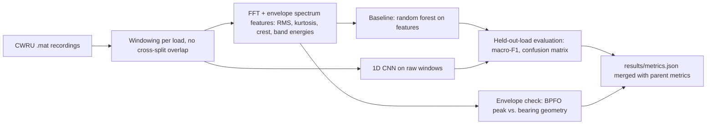

# Predictive Maintenance with Vibration Signals - Spectral and Envelope Features, 1D CNN Fault Classification, on Top of the Ops Pipeline

`predictive-maintenance-vibration` · extend project · estimated build effort: 4 h

## Problem

Extends the verified predictive-maintenance project (predictive-maintenance-ops) with the vibration-analysis layer that condition-monitoring teams rely on: accelerometer signals from a public bearing test rig are windowed, transformed to FFT and envelope spectra, and classified into fault types with both a hand-crafted-feature baseline and a 1D CNN, evaluated on a motor load never seen in training (avoiding the known window-overlap leakage in this dataset). Envelope analysis checks that the outer-race fault frequency appears where bearing physics predicts. All previous tests and metrics must still pass.

## Target jobs and skills

- **AssetWatch — Machine Learning Engineer, Predictive Maintenance** (`45d70997c80c`): covers 74% of the JD's weighted top skills (Python, Signal Processing, Predictive Maintenance, Time Series, Anomaly Detection, Deep Learning, Feature Engineering, CNN, PyTorch, SQL)

Skills/tools this project demonstrates: Python, SQL, Time Series, Anomaly Detection, Predictive Maintenance, Machine Learning, Gradient Boosting, LightGBM, Deep Learning, PyTorch, Statistics, Feature Engineering, Signal Processing, CNN

## Data

- **Dataset:** Case Western Reserve University Bearing Data Center (12 kHz drive-end accelerometer data) — https://engineering.case.edu/bearingdatacenter/download-data-file
- **License/terms:** Publicly provided by CWRU for research use (cite the Bearing Data Center)
- **Size used:** ~40 .mat files, ~200 MB (downloaded by script; normal + inner race, outer race, ball faults at 3 sizes)
- **Plan:** Train and validate on motor loads 0-2 hp; test on load 3 hp only. Windows are cut per recording without overlap across splits. Parent project data and splits are unchanged.

## Architecture

## Tech stack

Python 3.11, NumPy, SciPy (signal), scikit-learn, PyTorch (CPU), matplotlib, pytest

## Deliverables

- vibration/ package with loaders, windowing, FFT and envelope (Hilbert) features
- Random-forest feature baseline and a 1D CNN fault classifier, both evaluated on the held-out load
- Envelope-spectrum check comparing the detected outer-race fault peak with the BPFO computed from bearing geometry
- Updated README section, plots of spectra and confusion matrices; parent pipeline still runs from run.py

## Success criteria (all must hold on a from-scratch `python run.py`)

| Metric | Threshold | How it is measured |
|---|---|---|
| Macro-F1 on held-out motor load (10 classes) | >= 0.90 for the best model | test on load 3 hp, scored once |
| Best model vs. feature baseline | best macro-F1 >= baseline macro-F1 + 0.03, or both >= 0.95 with the comparison reported | same split |
| Envelope fault-frequency check | detected outer-race peak within 2% of the BPFO computed from bearing geometry | envelope module test |
| No leakage | no window shares samples with a window in another split (asserted in tests) | pytest |
| Parent project | all previous tests pass and headline metrics reproduce within 2% | re-run |
| Test coverage of src/ and vibration/ | >= 75% | pytest --cov |

## Evaluation artifacts (required; the evaluator recomputes metrics from these)

- results/vibration_test_predictions.csv with columns window_id, recording, load_hp, label, cnn_pred, baseline_pred
- results/vibration_splits.json with keys train_recordings, val_recordings, test_recordings, and window sample ranges per recording
- results/envelope_check.json with keys bpfo_hz_theory, bpfo_hz_detected, rel_error

## Baseline

Random forest on classical vibration features (RMS, kurtosis, crest factor, spectral band energies).

## Constraints

- Runs on Windows with `python run.py` from a fresh virtualenv; no make, shell scripts, paid APIs, or accounts.
- CPU-only by default (an optional `--device cuda` flag is fine); peak RAM <= 3 GB; total downloads <= 1.5 GB.
- PyTorch (if used) pinned to the CPU wheel via `--extra-index-url https://download.pytorch.org/whl/cpu`.
- Fixed random seeds; every reported number is written by code to results/metrics.json (never typed by hand).
- Test split is created once, saved, and never used for training, tuning, or threshold selection.
- Data download is scripted (Python requests), cached under data/, and verified by checksum or row count.
- Public test-rig data only; never claim deployment on customer machines or real IIoT fleets.

## Draft resume bullets (placeholders are filled only with reproduced metrics)

- Classified 10 bearing fault conditions from accelerometer signals with a 1D CNN at [F1] macro-F1 on an unseen motor load vs. [BASE_F1] for a spectral-feature random forest
- Built FFT and envelope-spectrum features; the detected outer-race fault peak matched bearing-geometry BPFO within [BPFO_ERR]%
- Prevented the dataset's known window-overlap leakage by splitting on motor load, with leakage checks in tests
